# ERD: NEXAMed v1

**Version**: v1.80 — 20/10/2026 (xem mục 9 để biết 5 phiên bản mới nhất; lịch sử đầy đủ ở `docs/archive/ERD-lich-su-phien-ban-v1.0-v1.77.md`)
**Cách đọc (chốt 20/10/2026)**: file này giữ sơ đồ tổng thể, nhóm bảng nền (3.1–3.5), ràng buộc, index, thứ tự tạo bảng. Nhóm bảng 3.6 trở đi (Thu ngân, Kho Thuốc & Vật tư, Công nợ NCC, và MỌI nhóm bảng mới) ở **`docs/ERD-2.md`** — mở khi làm việc với các bảng đó.
**Phạm vi**: các bảng thuộc v1 (Đặt lịch, Tiếp nhận, Khám bệnh, Kê đơn) cộng các mở rộng phạm vi đã chốt (Thu ngân cơ bản, Sổ quỹ & Thu chi, Ví tạm ứng, Kho Thuốc & Vật tư y tế GĐ1→4, Công nợ nhà cung cấp Phần A→D — xem `CLAUDE.md`). Bảng của v2+ (viện phí đầy đủ, BHYT), Kho Thuốc GĐ5, và Công nợ NCC Phần E (chưa có mockup, chưa code) **không** tạo ở giai đoạn này.
**Căn cứ**: `docs/product/prd.md` v1.0, `docs/product/plan.md` v1.0, `.claude/docs/data-model.md`

---

## 1. Quy ước đọc sơ đồ

- Mọi bảng nghiệp vụ đều có đủ 8 cột bắt buộc: `id`, `tenant_id`, `created_at`, `updated_at`, `deleted_at`, `version`, `created_by`, `updated_by`. Trong sơ đồ chỉ vẽ `id`, `tenant_id` và các cột đặc thù để dễ đọc.
- Ngoại lệ: `icd10_catalog` (danh mục toàn hệ thống, không có `tenant_id`) và `audit_log` (append-only, không có `updated_at`, `deleted_at`, `version`).
- Khoá ngoại giữa các bảng nghiệp vụ là **composite** `(tenant_id, id)` để không thể trỏ chéo tenant.
- Tiền dùng `bigint` đơn vị đồng; thời gian dùng `timestamptz` lưu UTC.

---

## 2. Sơ đồ tổng thể

```mermaid
erDiagram
    TENANT ||--o{ TENANT_SETTING : "cau hinh"
    TENANT ||--o{ ROOM : "co"
    TENANT ||--o{ WORK_SHIFT : "co danh muc ca"
    TENANT ||--o{ USER_ACCOUNT : "co"
    TENANT ||--o{ CODE_SEQUENCE : "cap ma"
    TENANT ||--o{ PATIENT : "quan ly"
    TENANT ||--o{ DRUG : "danh muc thuoc"
    TENANT ||--o{ SUPPLIER : "nha cung cap"
    TENANT ||--o{ WAREHOUSE : "co kho"
    DRUG ||--o{ DRUG_UNIT : "quy doi don vi"
    DRUG ||--o{ DRUG_INGREDIENT : "hoat chat & ham luong"
    DEPARTMENT ||--o{ WAREHOUSE : "quan ly (tuy chon)"
    SUPPLIER {
        uuid id PK
        uuid tenant_id FK
        text code UK
        text name
        text tax_code
        text phone
        text address
        text contact_name
        boolean is_active
    }
    WAREHOUSE {
        uuid id PK
        uuid tenant_id FK
        text code UK
        text name
        uuid department_id FK
        boolean is_default
        boolean is_active
    }
    DRUG_UNIT {
        uuid id PK
        uuid tenant_id FK
        uuid drug_id FK
        text unit_code
        int sort_order
        int factor_to_unit_below
        bigint sell_price
    }
    DRUG_INGREDIENT {
        uuid id PK
        uuid tenant_id FK
        uuid drug_id FK
        text active_ingredient_code
        int strength_value
        text strength_unit_code
    }
    TENANT ||--o{ DEPARTMENT : "co"
    TENANT ||--o{ DEPARTMENT_TYPE : "co"
    TENANT ||--o{ ROLE : "co"

    DEPARTMENT_TYPE ||--o{ DEPARTMENT : "phan loai (tuy chon)"
    DEPARTMENT ||--o{ USER_ACCOUNT : "thuoc ve"
    DEPARTMENT ||--o{ ENCOUNTER : "khoa phu trach (hang doi ao)"
    DEPARTMENT_TYPE {
        uuid id PK
        uuid tenant_id FK
        text name
        boolean is_active
    }
    ROLE ||--o{ USER_ROLE : "gan cho"
    ROLE ||--o{ ROLE_PERMISSION : "duoc cau hinh"
    PERMISSION ||--o{ ROLE_PERMISSION : "ap dung"

    USER_ACCOUNT ||--o{ USER_ROLE : "duoc gan"
    USER_ACCOUNT ||--o{ APPOINTMENT : "bac si phu trach"
    USER_ACCOUNT ||--o{ ENCOUNTER : "bac si kham"
    USER_ACCOUNT ||--o{ AUDIT_LOG : "thuc hien"
    USER_ACCOUNT ||--o{ BREAK_GLASS_SESSION : "pha kinh"
    USER_ACCOUNT ||--o{ USER_SESSION : "dang nhap"
    USER_SESSION ||--o| USER_SESSION : "replaced_by"
    USER_ACCOUNT ||--o{ DOCTOR_ROOM_SESSION : "chon phong hom nay"
    ROOM ||--o{ DOCTOR_ROOM_SESSION : "duoc chon"
    DOCTOR_ROOM_SESSION {
        uuid id PK
        uuid tenant_id FK
        uuid doctor_id FK
        uuid room_id FK
        date work_date
    }
    FLOOR ||--o{ ROOM : "co (tuy chon)"
    ROOM ||--o{ EXAM_STATION : "co ban kham/ghe"
    FLOOR {
        uuid id PK
        uuid tenant_id FK
        text name
        int sort_order
        boolean is_active
    }
    EXAM_STATION {
        uuid id PK
        uuid tenant_id FK
        uuid room_id FK
        text name
        int sort_order
        boolean is_active
    }

    PATIENT ||--o{ INSURANCE_CARD : "co the"
    PATIENT |o--o{ APPOINTMENT : "gan sau khi tiep nhan"
    PATIENT ||--o{ ENCOUNTER : "den kham"
    PATIENT ||--o| PATIENT : "merged_into"
    PATIENT ||--o{ PATIENT_ALLERGEN : "di nguyen da biet"
    ALLERGEN ||--o{ PATIENT_ALLERGEN : "duoc gan"
    PATIENT_ALLERGEN {
        uuid id PK
        uuid tenant_id FK
        uuid patient_id FK
        uuid allergen_id FK
    }

    APPOINTMENT ||--o| ENCOUNTER : "sinh ra"
    ROOM ||--o{ APPOINTMENT : "dien ra tai"

    ENCOUNTER ||--o{ VITAL_SIGN : "sinh hieu"
    ENCOUNTER ||--o{ ENCOUNTER_SERVICE_ITEM : "chi dinh dich vu kham"
    ENCOUNTER ||--o{ DIAGNOSIS : "chan doan"
    ENCOUNTER ||--o{ CLINICAL_NOTE : "ghi chu SOAP"
    ENCOUNTER ||--o{ PRESCRIPTION : "don thuoc"

    ICD10_CATALOG ||--o{ DIAGNOSIS : "ma benh"
    REFERENCE_CATALOG {
        uuid id PK
        text category
        text code
        text name
        int sort_order
        boolean is_active
        bigint price
        text unit
        boolean deactivates_account
    }
    PROVINCE ||--o{ WARD : "co"
    PROVINCE {
        text code PK
        text name
        int sort_order
    }
    WARD {
        text code PK
        text name
        text province_code FK
        int sort_order
    }
    PRESCRIPTION ||--o{ PRESCRIPTION_ITEM : "dong thuoc"
    DRUG ||--o{ PRESCRIPTION_ITEM : "thuoc"

    PRESCRIPTION ||--o| PRESCRIPTION : "supersedes"
    CLINICAL_NOTE ||--o| CLINICAL_NOTE : "supersedes"
    DIAGNOSIS ||--o| DIAGNOSIS : "supersedes"

    TENANT {
        uuid id PK
        text name
        text tax_code
        text address
        text license_no
        boolean is_active
        text phone
        text email
        text currency
        text timezone
        text logo_key
        text print_logo_key
        text facility_code
        text professional_in_charge_name
        text website
        jsonb social_links_json
        text bank_account_name
        text bank_account_number
        text bank_name
    }

    USER_ACCOUNT {
        uuid id PK
        uuid tenant_id FK
        uuid department_id FK
        text employee_code
        text username UK
        text password_hash
        text full_name
        text phone
        text personal_email
        text company_email
        text license_no
        text academic_title_code
        text position_code
        text employment_status_code
        text employment_type_code
        boolean can_sign_medical_record
        boolean must_change_password
        boolean is_active
        int failed_login_count
        timestamptz last_failed_login_at
        timestamptz locked_until
    }

    USER_SESSION {
        uuid id PK
        uuid tenant_id FK
        uuid user_id FK
        text refresh_token_hash UK
        timestamptz issued_at
        timestamptz expires_at
        uuid replaced_by_session_id FK
        text ip
        text user_agent
    }

    DEPARTMENT {
        uuid id PK
        uuid tenant_id FK
        uuid department_type_id FK
        text code
        text name
        boolean is_active
        boolean is_default "Hang doi ao (#064) - dung 1 dong/tenant, seed luc tao tenant"
        boolean participates_in_queue "Co hien o GET /departments/options khong (#105) - mac dinh true"
    }

    ROLE {
        uuid id PK
        uuid tenant_id FK
        text name
        boolean is_system_default
    }

    PERMISSION {
        uuid id PK
        text module
        text action
        text description
    }

    ROLE_PERMISSION {
        uuid id PK
        uuid tenant_id FK
        uuid role_id FK
        uuid permission_id FK
        text data_scope
    }

    USER_ROLE {
        uuid id PK
        uuid tenant_id FK
        uuid user_id FK
        uuid role_id FK
    }

    BREAK_GLASS_SESSION {
        uuid id PK
        uuid tenant_id FK
        uuid actor_id FK
        text entity_type
        uuid entity_id
        text reason
        timestamptz occurred_at
        timestamptz expires_at
    }

    PATIENT {
        uuid id PK
        uuid tenant_id FK
        text patient_code UK
        text full_name
        date dob
        text gender
        text phone
        bytea national_id_enc
        text national_id_hash
        jsonb address_json
        text allergy_note
        text personal_history
        text family_history
        uuid merged_into_id FK
        uuid global_patient_ref
        timestamptz identity_verified_at
        text photo_key
        date national_id_issued_at
        text national_id_issued_place
        text ethnicity
        text nationality
        text occupation
        text insurance_number
        text relative_full_name
        text relative_relationship
        text relative_phone
        text relative_address
    }

    INSURANCE_CARD {
        uuid id PK
        uuid tenant_id FK
        uuid patient_id FK
        bytea card_no_enc
        date valid_from
        date valid_to
        smallint benefit_rate
    }

    APPOINTMENT {
        uuid id PK
        uuid tenant_id FK
        uuid patient_id FK "NULL, gan sau khi Tiep nhan (v1 chua co)"
        uuid doctor_id FK
        uuid room_id FK
        text booking_code UK
        text full_name
        text phone
        text reason
        timestamptz scheduled_at
        int duration_minutes
        text status
        text source
        text cancel_reason
        uuid rescheduled_from_id FK "NULL, lich MOI tro ve lich CU khi Doi lich"
    }

    ENCOUNTER {
        uuid id PK
        uuid tenant_id FK
        uuid patient_id FK
        uuid doctor_id FK "NULL, hang doi ao (#064) - chua duoc bac si nao nhan"
        uuid department_id FK "bat buoc, hang doi ao (#064)"
        uuid appointment_id FK
        text encounter_no UK
        text status
        text specialty
        timestamptz checked_in_at
        timestamptz started_at
        timestamptz completed_at
        text chief_complaint
        jsonb insurance_snapshot
        text cancel_reason
        text patient_source_code
        text exam_type_code "DEPRECATED #080, xem ENCOUNTER_SERVICE_ITEM"
        text exam_type_name "DEPRECATED #080"
        bigint exam_type_price "DEPRECATED #080"
        text reception_type_code
        text exam_form_code
        boolean is_priority
        text priority_reason_code
        text price_type_code "DEPRECATED #080"
        text exam_type_unit "DEPRECATED #080"
        int service_quantity "DEPRECATED #080"
    }

    VITAL_SIGN {
        uuid id PK
        uuid tenant_id FK
        uuid encounter_id FK
        smallint pulse
        smallint temperature_deci_c
        smallint bp_systolic
        smallint bp_diastolic
        smallint respiratory_rate
        smallint spo2
        int weight_gram
        int height_mm
        timestamptz measured_at
    }

    ENCOUNTER_SERVICE_ITEM {
        uuid id PK
        uuid tenant_id FK
        uuid encounter_id FK
        text exam_type_code
        text exam_type_name
        text price_type_code
        text unit_code
        bigint exam_type_price
        int quantity
    }

    DIAGNOSIS {
        uuid id PK
        uuid tenant_id FK
        uuid encounter_id FK
        text icd10_code FK
        text type
        text note
        timestamptz signed_at
        uuid signed_by FK
        uuid supersedes_id FK
        text amendment_reason
    }

    CLINICAL_NOTE {
        uuid id PK
        uuid tenant_id FK
        uuid encounter_id FK
        text section
        text content
        timestamptz signed_at
        uuid signed_by FK
        uuid supersedes_id FK
        text amendment_reason
    }

    PRESCRIPTION {
        uuid id PK
        uuid tenant_id FK
        uuid encounter_id FK
        timestamptz signed_at
        uuid signed_by FK
        bytea signature_payload
        timestamptz printed_at
        uuid supersedes_id FK
        text amendment_reason
        jsonb acknowledged_warnings
    }

    PRESCRIPTION_ITEM {
        uuid id PK
        uuid tenant_id FK
        uuid prescription_id FK
        uuid drug_id FK "nullable — kê thuốc tự do dùng free_text_drug_name"
        text free_text_drug_name
        smallint dose_morning "v1.xx #196, thay dose/frequency"
        smallint dose_noon
        smallint dose_afternoon
        smallint dose_evening
        smallint duration_days
        int quantity "backend tự tính = tổng 4 buổi × duration_days"
        text instruction
    }

    DRUG {
        uuid id PK
        uuid tenant_id FK
        text code UK
        text name
        text active_ingredient
        text unit
        text concentration
        boolean is_active
        text item_type
        boolean is_batch_managed
        text base_unit_code
        bigint default_sell_price
        boolean unit_pricing_enabled
        text drug_group_code
        text route_code
        text national_code
        text manufacturer
        int min_stock_alert
        int max_stock_alert
    }

    ICD10_CATALOG {
        text code PK
        text name_vi
        text name_en
        text search_key
        text chapter_code
        text chapter_name
        text block_code
        text block_name
        text group_code
        text group_name
        boolean is_billable
        text gender_restriction
        text usage_restriction
        text who_note
    }

    ROOM {
        uuid id PK
        uuid tenant_id FK
        uuid floor_id FK
        text name
        boolean is_active
    }

    WORK_SHIFT {
        uuid id PK
        uuid tenant_id FK
        text name
        text code UK
        text start_time
        text end_time
        text color
        text rest_start_time
        text rest_end_time
        int rest_minutes
        int standard_work_minutes
        int sort_order
        boolean is_active
    }

    TENANT_SETTING {
        uuid id PK
        uuid tenant_id FK
        text key UK
        jsonb value
    }

    CODE_SEQUENCE {
        uuid id PK
        uuid tenant_id FK
        text prefix UK
        bigint current_value
    }

    AUDIT_LOG {
        uuid id PK
        uuid tenant_id FK
        uuid actor_id FK
        text action
        text entity_type
        uuid entity_id
        jsonb before_json
        jsonb after_json
        inet ip
        timestamptz occurred_at
    }
```

---

## 3. Nhóm bảng theo vai trò

### 3.1 Nền tảng và tenant

| Bảng | Vai trò | Ghi chú |
|---|---|---|
| `tenant` | Một phòng khám | Bảng gốc; `tenant_id` của chính nó là `id`. Trang "Thông tin phòng khám" (2026-08-13) thêm `phone`/`email`/`currency`/`timezone`/`logo_key`/`print_logo_key` — xem `docs/DECISIONS.md` #041. Mở rộng tiếp (2026-09-14) `facility_code`/`professional_in_charge_name`/`website`/`social_links_json`/`bank_account_name`/`bank_account_number`/`bank_name` — xem `docs/DECISIONS.md` #140 |
| `tenant_setting` | Cấu hình theo phòng khám | Giờ làm việc, `slot_duration_minutes`, `overdue_wait_warning_minutes` (ngưỡng "chờ lâu" Hàng đợi khám, mặc định 30, #087), ngưỡng no-show, ngưỡng sinh hiệu, mẫu in. Unique `(tenant_id, key)` |
| `room` | Phòng khám vật lý | |
| `tenant` (cột mới v1.75) | Công ty — Đợt 4 SaaS (`docs/DECISIONS.md` #237) | `code` UNIQUE (CHECK nhãn DNS 3-30 ký tự chữ thường/số/gạch ngang; trigger chặn đổi sau khi đã đặt; NULL với công ty tạo trước SaaS) = tên miền phụ; `suspended_at`/`suspended_reason`/`suspended_by` (tạm ngưng ⇒ bắt buộc có lý do); `contact_name`/`contact_phone`/`contact_email`/`operator_note` là thông tin VẬN HÀNH, tách khỏi `phone`/`email` của phòng khám |
| `platform_operator` | Người vận hành nền tảng SaaS (v1.75, #237) | KHÔNG `tenant_id`/RLS (ngoại lệ có chủ đích như `permission`). `username` UNIQUE, `password_hash` Argon2id, `totp_secret_enc` (AES-256-GCM, base64) cho OTP; `failed_login_count`/`last_failed_login_at`/`locked_until` khoá tạm; `is_active`. Chỉ có `id`/`created_at`/`updated_at`/`version` trong 8 cột bắt buộc |
| `platform_audit_log` | Nhật ký vận hành nền tảng (v1.75, #237) | Append-only (app role không UPDATE/DELETE), KHÔNG `tenant_id`; `operator_id`, `action`, `target_tenant_id` (không khoá ngoại để nhật ký tồn tại độc lập), `detail_json` (chỉ `note` lý do), `ip`, `user_agent`, `occurred_at`; index `(target_tenant_id, occurred_at DESC)` và `(occurred_at DESC)` |
| `branch` | Chi nhánh của công ty (v1.73, `docs/DECISIONS.md` #231) | `tenant` = công ty, chi nhánh nằm BÊN TRONG. Mọi tenant luôn có ≥ 1 chi nhánh mặc định (`is_default`, partial unique 1/tenant); `code` tự sinh `CNxxxxx`; `is_active` (mặc định không ngưng được). Chi nhánh KHÔNG phải ranh giới bảo mật cấp DB (RLS vẫn theo `tenant_id`) mà là lớp lọc ứng dụng + khoá ngoại kép `(tenant_id, branch_id)` |
| `user_branch` | Nhân viên ↔ chi nhánh được làm việc (v1.73) | Partial unique `(tenant_id, user_id, branch_id) WHERE deleted_at IS NULL`. Công ty ≤ 1 chi nhánh hoạt động thì không cần dòng nào (mọi tài khoản coi như thuộc chi nhánh đó); thêm chi nhánh thứ 2 thì tài khoản chưa có dòng được gán vào chi nhánh mặc định. Phiên đăng nhập mang "chi nhánh hiện hành" (`user_session.branch_id`, claim `bid`) |
| `branch.facility_code` | Mã cơ sở khám chữa bệnh 5 chữ số của chi nhánh (v1.78, `docs/DECISIONS.md` #242) | Cột nullable `TEXT`, `CHECK (facility_code ~ '^[0-9]{5}$')`. NULL = dùng `tenant.facility_code` (mã công ty, text tự do cũ) nếu hợp lệ. Là 5 ký tự đầu của mã đơn thuốc chuẩn Bộ Y tế `xxxxxyyyyyyy-z`. Bộ đếm mã đơn chuẩn KHÔNG có bảng riêng: dùng `code_sequence` với `prefix='DTQG'`, `period_key` = mã cơ sở (mỗi cơ sở một bộ đếm 7 chữ số chung 4 loại đơn, không đánh số lại). |
| `work_shift` | Danh mục "Ca làm việc" (v1.36, `docs/DECISIONS.md` #101) | Mẫu ca (tên/giờ/màu/giờ nghỉ/số giờ công chuẩn) do `clinic_admin` tự quản lý qua UI — RIÊNG theo `tenant_id`, KHÔNG dùng chung khuôn `reference_catalog` (toàn hệ thống) vì mỗi phòng khám tự đặt giờ ca. `code` tự sinh, unique `(tenant_id, code)`. Có `@@unique([tenant_id, id])` (thêm ở v1.37) làm đích FK từ `work_shift_assignment` |
| `work_shift_assignment` | "Đăng ký ca làm việc" — Giai đoạn 2 (v1.37, `docs/DECISIONS.md` #102) | MỌI nhân viên tự đăng ký ca (từ `work_shift`) cho 1 ngày cụ thể (`work_date`, nhận từ client — khác `doctor_availability`/`doctor_room_session` luôn ép "hôm nay"). Nhiều dòng/ngày được (Sáng+Chiều), unique `(tenant_id, user_id, work_date, work_shift_id) WHERE deleted_at IS NULL` chặn trùng đúng 1 ca. Tự sửa/xoá tự do TRONG ĐÚNG NGÀY LỊCH VN đã tạo (`created_at`, kiểm ở Service) — khoá lại từ hôm sau, chỉ scope `global` (mặc định `clinic_admin`) sửa/xoá tự do |
| `leave_request` | "Đơn xin nghỉ" (`docs/DECISIONS.md` #224) | Nhân viên xin nghỉ MỘT NGÀY trên ca đã đăng ký (`work_shift_id` NULL = cả ngày); `start_minute`/`end_minute` = snapshot khung nghỉ theo phút giờ VN (cả ngày 0–1440). `status` PENDING/APPROVED/REJECTED/WITHDRAWN/CANCELLED, `reason` bắt buộc, `decision_reason` bắt buộc khi từ chối/huỷ, `filed_on_behalf`. Partial unique `(tenant_id, user_id, leave_date, COALESCE(work_shift_id, nil)) WHERE status IN (PENDING,APPROVED) AND deleted_at IS NULL` chống trùng; CHECK khung giờ/trạng thái; FK composite tới `user_account`/`work_shift`. Ca đã đăng ký giữ nguyên |
| `work_schedule_submission` | "Duyệt đăng ký ca theo tháng" (`docs/DECISIONS.md` #225) | Bảng đăng ký ca THEO THÁNG của từng nhân viên: `month` `YYYY-MM`, `status` DRAFT/SUBMITTED/APPROVED, `return_reason`/`returned_at` (trả lại = về DRAFT), `submitted_at`, `decided_by/at`. Không có dòng = Nháp ảo. Partial unique `(tenant_id, user_id, month) WHERE deleted_at IS NULL`; CHECK regex tháng + trạng thái |
| `shift_swap_request` | "Đổi ca" (`docs/DECISIONS.md` #225) | Đổi 2 ca cho nhau: `requester_id/assignment_id`, `counterpart_id/assignment_id` (FK composite tới `work_shift_assignment` — thêm `UNIQUE(tenant_id,id)`), `status` PENDING/ACCEPTED/DECLINED/CANCELLED, `manager_seen_at` (NULL = mới), `decline_reason`. 2 partial unique chặn 2 yêu cầu PENDING cùng một ca; CHECK requester ≠ counterpart. "Quá hạn" tính lúc đọc |
| `department_type` | "Loại Khoa/Phòng" (mở rộng ADM-01, 2026-08-20) | Cấp cha tùy chọn của `department`, cùng khuôn `floor`/`room`. Chỉ tổ chức/phân loại, không ảnh hưởng logic nghiệp vụ |
| `department` | Khoa/phòng trong tenant | Phục vụ Data Scope `department`; v1 phần lớn phòng khám không dùng nhưng bảng luôn tồn tại. `code` tự sinh (prefix `KP`), `department_type_id` tuỳ chọn, `is_active` quản lý qua UI (2026-08-20). **`is_default`** (v1.23, `docs/DECISIONS.md` #064) — đúng 1 Khoa "mặc định" ("Khoa chung") mỗi tenant, tự seed lúc tạo tenant (`seedDefaultRolesForTenant`), dùng làm fallback `encounter.department_id` khi bác sĩ chưa gán Khoa hoặc lúc Tiếp nhận chọn thẳng "Khoa chung" — ép đúng 1 dòng/tenant bằng partial unique index (C16) |
| `user_account` | Tài khoản người dùng | `password_hash` Argon2id; `license_no` cho bác sĩ; `department_id` tuỳ chọn. Mở rộng ADM-01 (2026-08-20): hồ sơ nhân sự đầy đủ (`employee_code` tự sinh, SĐT/email cá nhân+công ty, học vị/chức danh/trạng thái+hình thức làm việc — mã tham chiếu `reference_catalog`, `can_sign_medical_record`, `must_change_password`). **Redesign 3-tab (v1.30, 2026-08-27, `docs/DECISIONS.md` #082)**: `personal_email`/`company_email` GỘP thành 1 cột `email` (đổi tên cột, xoá `company_email`); thêm `dob`/`gender` (2 giá trị `male`/`female`); thêm `display_name` (tên hiển thị — bắt buộc lúc tạo mới, tự gợi ý ghép Học vị/Học hàm + Họ tên ở web, dùng khi in đơn thuốc/HSBA); thêm `license_issued_at`/`license_issued_place` (ngày/nơi cấp CCHN, đi cùng `license_no` có sẵn); thêm `signature_key` (ảnh chữ ký PNG, khoá lưu StoragePort — cùng khuôn `patient.photo_key`, chỉ upload được sau khi tài khoản đã tồn tại); thêm `default_room_id` (composite FK tuỳ chọn → `room`, "Phòng khám mặc định" — THUẦN gợi ý hiển thị, không đổi cơ chế "Phòng làm việc hôm nay" `doctor_room_session` #054) |
| `role` | Vai trò theo tenant | Seed 5 vai trò mặc định lúc tạo tenant, `clinic_admin` tạo thêm được. Unique `(tenant_id, name)` |
| `permission` | Danh mục hành động toàn hệ thống | Không có `tenant_id`, seed cố định theo code (giống `icd10_catalog`). Unique `(module, action)` |
| `role_permission` | Ma trận phân quyền | `(role_id, permission_id) → data_scope` (`none`/`personal`/`department`/`global`). Unique `(tenant_id, role_id, permission_id)` |
| `user_role` | Gán vai trò cho user | Bảng nối, một người có nhiều vai trò. Unique `(tenant_id, user_id, role_id)` |
| `break_glass_session` | Phiên vượt quyền tạm thời | Append-only, `expires_at` giới hạn thời hạn (mặc định 2 giờ, cấu hình qua `tenant_setting`) |
| `user_session` | Phiên refresh token | Rotation + reuse detection (S1-04); thu hồi = soft delete (`deleted_reason`: `logout`/`rotated`/`expired`/`reuse_detected`/`account_disabled`) |
| `code_sequence` | Cấp mã hiển thị theo tenant | `SELECT ... FOR UPDATE` trong transaction. Thêm cột `period_key` (v1.41, `docs/DECISIONS.md` #114) — khoá duy nhất `(tenant_id, prefix, period_key)`, `''` mặc định = không reset (tương thích ngược tuyệt đối) |
| ~~`global_code_sequence`~~ | **ĐÃ BỎ (v1.72, #230)** — gộp vào `code_sequence` (khoá `CATALOG:<tiền tố>`) vì danh mục nay riêng theo tenant. Mô tả cũ: cấp mã ngắn tuần tự cho danh mục TOÀN HỆ THỐNG (v1.40, `docs/DECISIONS.md` #113) | Không `tenant_id` (đúng bản chất `reference_catalog`/`allergen_group`/`allergen` mà bảng này phục vụ) — khoá theo `prefix`, cùng cơ chế atomic `INSERT ... ON CONFLICT` như `code_sequence` |
| `audit_log` | Nhật ký | Append-only, quyền DB chỉ `INSERT`/`SELECT` |

### 3.2 Bệnh nhân

| Bảng | Vai trò | Ghi chú |
|---|---|---|
| `patient` | Hồ sơ hành chính | `national_id_enc` mã hoá AES-256-GCM; `national_id_hash` để tra trùng; `address_json` lưu địa chỉ (PAT-01) |
| `insurance_card` | Thẻ BHYT | v1 chỉ lưu và hiển thị, không tính chi trả |
| `patient_allergen` | Dị nguyên đã biết | **Mới (Sprint 4, `docs/DECISIONS.md` 2026-08-25)** — bảng NỐI `patient` ↔ `allergen` (danh mục "Dị nguyên" toàn hệ thống, #069), phục vụ PRE-03 chính xác hơn `patient.allergyNote` tự do. Đủ 8 cột bắt buộc (dữ liệu nghiệp vụ chạm bệnh nhân, khác danh mục hệ thống). `allergenId` FK thường (không composite) tới `allergen.id` — cùng khuôn `diagnosis.icd10Code`. `patient.allergyNote` GIỮ NGUYÊN làm ghi chú bổ sung tự do, không đổi/xoá |
| `patient_condition` | Bệnh lý nền + thói quen/lối sống có cấu trúc | **Mới (Sprint 5, 25/08/2026)** — mảng mã ICD-10 (bệnh lý nền VÀ thói quen dùng chung, thói quen mã hoá Chương XXI Z72.x), thay khối chip "Tiền sử bản thân" text tự do cũ. `icd10Code` FK thường tới `icd10_catalog.code`. Đủ 8 cột bắt buộc, partial unique `(tenant_id, patient_id, icd10_code) WHERE deleted_at IS NULL` (C19) |
| `patient_family_history` | Tiền sử gia đình có cấu trúc | **Mới (Sprint 5, 25/08/2026)** — ma trận Quan hệ huyết thống (`relation`, enum `FamilyRelation` 5 giá trị) × Bệnh lý (`icd10Code`, FK thường) × `age_of_onset_years` (nullable). Đủ 8 cột bắt buộc. KHÔNG unique — nhiều người thân cùng quan hệ có thể cùng mắc 1 bệnh, mỗi người 1 dòng riêng. Thay `patient.familyHistory` (text tự do cũ, cột DB giữ nguyên nhưng ngừng đọc/ghi từ UI) |

`patient.merged_into_id` tự trỏ về `patient` trong cùng tenant, dùng cho luồng gộp hồ sơ trùng (PAT-04). Bản ghi nguồn không xoá, chỉ ngừng cho tạo lượt khám mới.

`patient.global_patient_ref` và `patient.identity_verified_at` luôn `NULL` ở v1. Hai cột này để sẵn cho hồ sơ dùng chung liên tenant ở v3+ (`identity_verified_at` ghi thời điểm xác minh danh tính khi bật master patient index); mọi tra cứu hiện tại đi qua `PatientIdentityPort`.

**Mở rộng hồ sơ hành chính (v1.6, `docs/DECISIONS.md` #034)**: `photo_key` (key lưu trên `StoragePort`, phục vụ qua signed URL có hạn — không lưu URL trực tiếp), `national_id_issued_at`/`national_id_issued_place` (ngày/nơi cấp CCCD), `ethnicity`/`nationality`/`occupation` (ban đầu text tự do, chưa có danh mục DB chính thức — cả 3 đều đã đảo ngược sang mã tham chiếu `reference_catalog`, xem #037/#061 bên dưới), `insurance_number` (độc lập với `insurance_card`), `relative_full_name`/`relative_relationship`/`relative_phone`/`relative_address` (đúng 1 người thân trên mỗi hồ sơ, không tách bảng). `address_json` thêm khoá `neighborhood` (Khu phố); `district` (Quận/Huyện) vẫn hợp lệ trong dữ liệu cũ nhưng không còn nhập trên UI.

**`address_json.province`/`.ward` (v1.8, `docs/DECISIONS.md` #038, đảo ngược tiếp phần Tỉnh/Xã của #034)**: nay lưu **mã** tham chiếu bảng `province`/`ward` mới (ví dụ `"1"`, `"10105001"`), không lưu tên — cùng cách `ethnicity`/`nationality` đã làm ở #037. Chọn qua Combobox cascading (chọn Tỉnh trước để lọc Xã) ở web thay vì gõ tay.

**`personal_history`/`family_history` (v1.24, `docs/DECISIONS.md` #068)** — chuyển từ `clinical_note.section` (`PERSONAL_HISTORY`/`FAMILY_HISTORY`, gắn theo từng `encounter_id`) sang đây, đúng khuôn `allergy_note`: dữ liệu chung của bệnh nhân, ít đổi giữa các lần khám, sửa tại chỗ qua `PATCH /patients/:id` (permission `doctor.patient.update=global` đã có sẵn từ #060) thay vì phải nhập lại từ đầu mỗi lượt khám mới — đúng lỗ hổng chủ dự án phát hiện khi dùng thử.

**Tiền sử bản thân/gia đình chuyển sang dữ liệu có cấu trúc (v1.26, Sprint 5, 25/08/2026)** — mockup Artifact duyệt qua 2 vòng chỉnh sửa. `patient.family_history` (text tự do) GIỮ NGUYÊN trong DB nhưng KHÔNG còn đọc/ghi từ UI mới — thay bằng bảng `patient_family_history` (mới, xem model riêng bên dưới). `patient.personal_history` GIỮ NGUYÊN Ý NGHĨA làm ghi chú bổ sung tự do, cạnh chip bệnh lý nền có cấu trúc lưu ở bảng `patient_condition` (mới) — bệnh lý nền VÀ thói quen/lối sống (hút thuốc/rượu bia/lười vận động) đều lưu chung bảng này bằng mã ICD-10 (thói quen dùng Chương XXI Z72.x), không tách cột riêng. `patient.allergy_note` GIỮ NGUYÊN trong DB, KHÔNG còn đọc/ghi từ UI mới (field "Ghi chú dị ứng khác" đã bỏ khỏi giao diện theo yêu cầu). Đồng thời mở quyền `allergen_catalog.create` (tạo mới, KHÔNG sửa/ẩn) cho lễ tân/điều dưỡng/bác sĩ — trước đây chỉ `clinic_admin` (`allergen_catalog.manage`) tạo được, để cho phép thêm dị nguyên mới ngay lúc nhập Tiền sử.

### 3.3 Lịch hẹn và lượt khám

| Bảng | Vai trò |
|---|---|
| `appointment` | Lịch hẹn; `status`: `SCHEDULED`, `CANCELLED`, `NO_SHOW`, `CONVERTED`, `RESCHEDULED` |
| `encounter` | Lượt khám; `status`: `SCHEDULED`, `CHECKED_IN`, `IN_CONSULTATION`, `COMPLETED`, `CANCELLED`, `NO_SHOW`. **"Hàng đợi ảo"** (v1.23, `docs/DECISIONS.md` #064) — `doctor_id` nay **nullable** (`NULL` = lượt khám còn trong hàng chờ chung Khoa, chưa được bác sĩ nào nhận qua "Nhận ca"); thêm `department_id` **bắt buộc** (suy từ Khoa của bác sĩ đã chọn, hoặc client chọn thẳng khi routing "theo Khoa, chưa rõ bác sĩ"). **Huỷ lượt khám + hoàn tiền (v1.33, `docs/DECISIONS.md` #085)**: state machine thêm 2 cạnh `IN_CONSULTATION → CANCELLED` (khách bỏ về giữa chừng) và `IN_CONSULTATION → CHECKED_IN` (nhả `doctor_id` về `NULL`, "Trả về hàng chờ" — ĐƯỜNG LÙI ĐẦU TIÊN của state machine này, không vi phạm quy tắc "không đường lùi từ COMPLETED") |

`encounter.appointment_id` cho phép `NULL` để hỗ trợ walk-in tạo trực tiếp — v1.11 hiện thực đúng thiết kế này: "Tiếp nhận bệnh nhân" (`POST /reception/direct`) tạo thẳng `encounter` với `appointment_id = NULL`, KHÔNG qua `appointment` (khác hướng ban đầu dự tính đi qua `appointment` với `source='walk_in'` — đã đổi theo yêu cầu chủ dự án, xem `docs/DECISIONS.md`). Quan hệ `appointment↔encounter` là một-không-hoặc-một: mỗi lịch hẹn sinh tối đa một lượt khám (ép bằng partial unique index `(tenant_id, appointment_id) WHERE appointment_id IS NOT NULL AND deleted_at IS NULL`, không khai `@unique` ở Prisma schema — cùng lý do `patient.national_id_hash`).

**Đặt lịch "lead capture" (v1.4, `docs/DECISIONS.md` #032)**: `appointment` **không** bắt buộc gắn `patient` lúc đặt — chỉ ghi nhận trực tiếp `full_name`/`phone`/`reason` (lý do khám, tuỳ chọn) trên chính bảng này, kèm `booking_code` (mã đặt lịch hiển thị cho khách, cùng khuôn `patient_code`/`encounter_no`: `<prefix><yyMM><seq6>`, prefix `LH`).

**"Sửa lịch" (tại chỗ) và "Dời lịch" (tạo lịch mới) — 2 thao tác tách biệt, tồn tại song song (v1.14, `docs/DECISIONS.md` #053)**: "Sửa lịch" (`PATCH /appointments/:id`) đổi giờ/bác sĩ/thời lượng TRONG NGÀY, cùng `id`, không đổi `status`. "Dời lịch" (`POST /appointments/:id/reschedule`, thay thế `PATCH .../reschedule` cũ của S2-09) đổi sang NGÀY KHÁC: lịch cũ chuyển `status='RESCHEDULED'` (giữ nguyên làm lịch sử, không sửa/xoá), một `appointment` MỚI được tạo (id/`booking_code` mới, `rescheduled_from_id` trỏ về lịch cũ — self-FK, không unique constraint, cùng khuôn `patient.merged_into_id`), kế thừa `full_name`/`phone`/`reason`/`room_id`/`duration_minutes`/`source` từ lịch cũ.

**Tiếp nhận thật (v1.10, Sprint 3, thay thế mô tả cũ "check-in chuyển thẳng SCHEDULED→CONVERTED, chưa có màn hình Tiếp nhận thật")** — HAI luồng tạo `encounter`, dùng CHUNG 1 biểu mẫu web (`ReceptionIntakeForm.tsx`, v1.12), khác route:
- **Check-in từ lịch hẹn có sẵn**: `POST /reception/check-in` đọc `appointment` đang `SCHEDULED`, tạo `encounter` (`status=CHECKED_IN`), gắn `patient_id` đã resolve xong ở web, và chuyển `appointment.status → CONVERTED` — cả ba **atomic trong 1 transaction** (module `reception` chia sẻ `AppointmentRepository`/`EncounterRepository` qua Nest `exports`, xem `docs/DECISIONS.md`). Kích hoạt bằng nút "Tiếp nhận" mở popup ngay trên panel chi tiết Lịch hẹn (bác sĩ/giờ cố định theo lịch hẹn, không sửa ở đây) — KHÔNG có trang hàng đợi riêng để làm việc này.
- **"Tiếp nhận bệnh nhân" (v1.11)**: `POST /reception/direct` — khách đến thẳng phòng khám, không qua đặt lịch trước. Tạo thẳng `encounter` (`appointment_id=NULL`). Trang web riêng "Tiếp nhận bệnh nhân" (menu con dưới "Tiếp nhận và Đặt lịch"), đủ trường ngày giờ/bác sĩ tự chọn.

Cả hai luồng đều lưu `patient_source_code` (mã danh mục `PATIENT_SOURCE`, tuỳ chọn) và "Chỉ định dịch vụ khám" — **danh sách NHIỀU dịch vụ** (v1.29, `docs/DECISIONS.md` #080, đảo ngược #052 điểm 6), tạo kèm N dòng `encounter_service_item` trong cùng transaction (bắt buộc ít nhất 1 dòng, xem mục 3.4) — và có thể kèm sinh hiệu (tuỳ chọn, tạo 1 dòng `vital_sign` trong cùng transaction nếu có nhập — v1.12).

Bản ghi từ CẢ HAI luồng cùng xuất hiện trong "Danh sách tiếp nhận" (`GET /reception/list`, lễ tân theo dõi trạng thái THUẦN — không có thao tác nào trên trang này, v1.12) và trang riêng "Hàng đợi khám" (cùng endpoint, thêm `doctorId` — bác sĩ chỉ thấy `CHECKED_IN` của chính mình dù `encounter.read` scope là `global`, lọc tường minh ở query chứ không dựa permission scope; "Bắt đầu khám" thực hiện NGAY TẠI ĐÂY, v1.12).

"Bắt đầu khám" (`CHECKED_IN→IN_CONSULTATION`) và "bỏ về" (`CHECKED_IN→CANCELLED`, bắt buộc lý do — cột `encounter.cancel_reason`) thuộc module `encounter` riêng (`POST /encounters/:id/start|cancel`), áp dụng chung cho encounter tạo từ cả hai luồng.

`encounter.insurance_snapshot` là bản chụp thẻ BHYT tại thời điểm check-in — v1 luôn `{ selfPay: true }` (module `insurance_card`/S2-04 chưa làm). Không join động về `insurance_card` khi in hay tra cứu về sau. `encounter_service_item.exam_type_price` chỉ **lưu để hiển thị** — v1 KHÔNG tính toán/xuất hoá đơn (viện phí ngoài phạm vi CLAUDE.md).

**Sinh hiệu bổ sung sau (v1.12)**: `POST /reception/encounters/:id/vital-signs` (REC-02/03, ngưỡng cảnh báo theo tuổi) vẫn tồn tại như hạ tầng riêng — dành cho lúc thiếu sinh hiệu ở bước tiếp nhận, module Khám bệnh (chưa xây) sẽ gọi lại đúng endpoint này để bổ sung/ghi lần đo mới. Không còn giao diện "Sinh hiệu" độc lập trên "Danh sách tiếp nhận" — sinh hiệu chính chuyển hẳn sang nhập cùng lúc tiếp nhận.

**Khung tối thiểu cho đa chuyên khoa (v1.5, `docs/DECISIONS.md` #033)**: `encounter.specialty` (text, mặc định `'general'`) — chuyên khoa thực tế của lượt khám này, KHÔNG phải của tenant (một phòng khám đa khoa có thể có nhiều `specialty` khác nhau trên các `encounter` khác nhau). v1 luôn `'general'`, chưa vai trò nào đọc/ghi giá trị khác — chỉ chuẩn bị chỗ để Sprint 3 không phải retrofit sau. Chưa thêm bảng tầng cha dài hạn (`pregnancy`/`treatment_plan`) hay cột `episode_id` — đó là việc của lúc thật sự làm gói chuyên khoa cụ thể, xem `docs/product/multi-specialty-analysis.md`.

**"Hàng đợi ảo" (v1.23, `docs/DECISIONS.md` #064)** — "Hàng đợi khám" KHÔNG phải bảng/thực thể riêng, chỉ là filter trên chính `encounter`: "Bệnh nhân của tôi" = `WHERE doctor_id = actor`; "Hàng chờ chung Khoa X" = `WHERE department_id = Khoa actor AND doctor_id IS NULL`. `doctor_id` đổi sang **nullable** (`NULL` = ticket đang chờ trong hàng chờ chung, chưa ai nhận); `department_id` **bắt buộc** trên mọi lượt khám, suy từ Khoa của bác sĩ được chọn lúc Tiếp nhận (server tự suy, không tin client gửi) hoặc client chọn thẳng khi routing "theo Khoa, chưa rõ bác sĩ". Mọi tenant luôn có sẵn 1 "Khoa mặc định" (`department.is_default`, C16) nên cột này không bao giờ thiếu giá trị hợp lệ. "Nhận ca" (mở rộng `POST /encounters/:id/start`) — bác sĩ CÙNG Khoa với ticket set `doctor_id = actor` atomic (`WHERE doctor_id IS NULL`, chống trùng kiểu fallback không WebSocket — 2 bác sĩ bấm gần như đồng thời thì người thua nhận `409 ENCOUNTER_ALREADY_CLAIMED` hoặc `404` tuỳ thời điểm đọc/ghi chồng lấn). `room`/`doctor_room_session` (#054) vẫn THUẦN điều phối vật lý, không phải khoá lưu hàng đợi. Nhóm "Hàng chờ chung" tự ẩn hoàn toàn khi tenant chỉ dùng 1 Khoa (đúng khuôn #054/#055).

### 3.4 Dữ liệu lâm sàng

| Bảng | Vai trò | Đặc thù |
|---|---|---|
| `vital_sign` | Sinh hiệu | Lưu số nguyên: nhiệt độ theo phần mười độ C (`temperature_deci_c`, 37.5°C → `375`), cân nặng theo gram, chiều cao theo mm |
| `encounter_service_item` | "Chỉ định dịch vụ khám" | **Mới (v1.29, `docs/DECISIONS.md` #080)** — danh sách NHIỀU dịch vụ/lượt khám, thay 6 cột `exam_type_*`/`price_type_code`/`exam_type_unit`/`service_quantity` DEPRECATED trên `encounter` (giữ nguyên trong DB, ngừng ghi từ Tiếp nhận mới). Mọi field SNAPSHOT lúc thêm — `price_type_code`/`unit_code`/`exam_type_price` cascade thật từ `exam_type_price` (#079, lọc dòng còn hiệu lực hôm nay), NULLABLE khi dịch vụ chưa được cấu hình đơn giá. Không có khái niệm ký/bất biến — sở hữu bởi module `reception` (cùng `vital_sign`), tạo trong CÙNG transaction check-in/tiếp nhận trực tiếp |
| `diagnosis` | Chẩn đoán | `type`: `PRIMARY` hoặc `SECONDARY`; bắt buộc có đúng một `PRIMARY` khi hoàn tất lượt khám. **Ký + đính chính (v1.34, Sprint 5, S5-02/03)** — 4 cột `signed_at`/`signed_by`/`supersedes_id`/`amendment_reason` mới (khác `clinical_note`/`prescription` đã có sẵn từ trước) |
| `clinical_note` | Ghi chú khám (nhóm "Thăm khám") | `section` (6 giá trị — `PERSONAL_HISTORY`/`FAMILY_HISTORY` chuyển sang `patient.personal_history`/`family_history` v1.24, xem #068): `REASON_FOR_VISIT`, `ILLNESS_PROGRESS`, `PRELIMINARY_DIAGNOSIS`, `GENERAL_EXAM`, `REGIONAL_EXAM`, `PLAN`. **Ký + đính chính (v1.34)** — cột đã có sẵn từ Sprint 3 nhưng chỉ tới Sprint 5 mới thật sự dùng (trigger C8 + service) |
| `prescription` | Đơn thuốc | **Đã hiện thực (Sprint 4, S4-01/02, `docs/DECISIONS.md` 2026-08-25)** — `SignableEntity` ĐẦU TIÊN trong dự án thật sự dùng logic ký (`SignaturePort`); ký logic ở v1, `signature_payload` để sẵn cho chữ ký số, luôn `NULL`. **C8 (mục 4) lần đầu là DB trigger THẬT** (chặn UPDATE `signedAt/signedBy/signaturePayload/encounterId/supersedesId/amendmentReason` khi đã ký — CHO PHÉP `printedAt`/soft-delete/version tiếp tục đổi). Đính chính tạo bản mới ĐÃ KÝ NGAY (không qua lại bước nháp). **Từ v1.34 (Sprint 5, S5-02/03), `diagnosis`/`clinical_note` cũng dùng đúng mô hình này** — "Hoàn tất khám" tự động ký cả hai, thay hẳn cơ chế "sửa tại chỗ" cũ (#066). Partial unique `(tenant_id, encounter_id) WHERE deleted_at IS NULL` — đúng 1 đơn đang hiệu lực/lượt khám |
| `prescription_item` | Dòng thuốc | **Đã hiện thực (Sprint 4)** — v1 không có cột giá, không trừ kho. Bulk-replace (xoá mềm + tạo lại) khi đơn CHƯA ký, đúng khuôn `diagnosis`. Liều dùng theo buổi Sáng/Trưa/Chiều/Tối (`dose_morning`/`dose_noon`/`dose_afternoon`/`dose_evening`, docs/DECISIONS.md #196) — thay 2 cột tự do `dose`/`frequency` cũ; `quantity` từ nay LUÔN do backend tính, đơn vị hiển thị resolve qua JOIN `drug.base_unit_code` (không snapshot cột riêng) |

`clinical_note` và `prescription` có `supersedes_id` + `amendment_reason` cho luồng đính chính: bản mới trỏ về bản cũ, bản cũ đặt `deleted_at` + `deleted_reason`.

### 3.5 Danh mục

| Bảng | Phạm vi | Ghi chú |
|---|---|---|
| `icd10_catalog` | Toàn hệ thống | Không có `tenant_id`, read-only lúc chạy, seed từ danh mục Bộ Y tế — v1.17 seed ĐỦ Chương I-XXII (15.844 mã, S3-01 mở khoá một phần, `docs/DECISIONS.md` #056). `search_key` là tên tiếng Việt đã bỏ dấu và viết thường (tái dùng `nexamed_unaccent_lower()` của `patient`), phục vụ tìm kiếm không dấu. `chapter_code`/`chapter_name`, `block_code`/`block_name`, `group_code`/`group_name` tách từ 3 cấp phân loại của WHO (thay field `chapter` đơn lẻ ở bản thiết kế trước v1.17). `chapter_code` là số La Mã ("I".."XXII") — thứ tự hiển thị đúng phải sắp ở tầng ứng dụng qua `romanToInt()` (`packages/core`), không sắp được theo thứ tự chuỗi ở DB. `gender_restriction`/`usage_restriction` chỉ hiển thị cảnh báo mềm ở trang tra cứu — chưa có logic chặn (thuộc S3-06/07, chưa xây) |
| `reference_catalog` | Toàn hệ thống | Dân tộc/Quốc tịch (`docs/DECISIONS.md` #037, đảo ngược #034) + Nguồn khách hàng/Loại khám (Sprint 3, v1.11) + Loại tiếp nhận/Hình thức khám/Lý do ưu tiên/Loại giá dịch vụ (v1.13, `docs/DECISIONS.md` #052) + Nghề nghiệp (v1.21, `docs/DECISIONS.md` #061, đảo ngược tiếp phần `occupation` của #034 — không seed cứng, `clinic_admin` tự thêm qua UI) + Học vị/Học hàm, Chức danh, Trạng thái làm việc, Hình thức làm việc (v1.22, mở rộng ADM-01, `docs/DECISIONS.md` #063 — 2 category đầu không seed cứng cùng lý do `OCCUPATION`; 2 category sau seed sẵn giá trị chuẩn) + Đơn vị tính (v1.27, 26/08/2026, mã tự sinh — không seed cứng) + Hình thức thanh toán (`PAYMENT_METHOD`, v1.32, seed sẵn `CASH`/`BANK_TRANSFER`, cột `counts_as_cash` — v1.39) + Loại thu chi (`INCOME_EXPENSE_TYPE`, v1.44, `docs/DECISIONS.md` #121, mã tự sinh tiền tố `TC` — thêm cột `direction`, enum `reference_catalog_direction`, CHỈ có ý nghĩa với category này, 2 giá trị `INCOME`/`EXPENSE` cố định không quản lý qua UI, dùng chung với `cash_voucher.direction` ở mục 3.6) — tái dùng nguyên bảng này thay vì tạo bảng riêng. Không `tenant_id`, **quản lý được qua API** bởi `clinic_admin` (khác `icd10_catalog`/`permission` — read-only lúc chạy) — "xoá" là `is_active=false` (soft), role DB không có quyền `DELETE`. Cột `price`/`unit` (bigint/text, nullable) chỉ có ý nghĩa với category `EXAM_TYPE` — lưu để hiển thị, chưa tính viện phí. Cột `deactivates_account` (boolean, mặc định `false`, v1.22) chỉ có ý nghĩa với category `EMPLOYMENT_STATUS` — mục "Nghỉ việc" đặt `true` để `user_account.employment_status_code` trỏ tới nó tự động vô hiệu hoá tài khoản, tách khỏi `code` (vốn sửa được qua UI) để không phụ thuộc vào việc admin không đổi tên mã. Cột `description` (text, nullable, v1.27) chỉ có ý nghĩa với category `UNIT` |
| `province` / `ward` | Toàn hệ thống | Tỉnh/Phường-Xã theo sáp nhập hành chính 2025, mã Bộ Nội vụ (`docs/DECISIONS.md` #038, đảo ngược tiếp phần Tỉnh/Xã của #034). Không `tenant_id`, **read-only lúc chạy** (giống `icd10_catalog`, khác `reference_catalog` — không có endpoint quản lý qua API). `ward.code` (8 chữ số) duy nhất toàn quốc, dùng thẳng làm PK |
| `drug` | Theo tenant | **Đã hiện thực (Sprint 4, S4-03; mở rộng GĐ1 Kho Thuốc v1.48, `docs/DECISIONS.md` #146/#148)** — v1 phòng khám tự nhập danh mục Thuốc & Vật tư y tế của mình. Cột gốc S4-03 giữ nguyên làm dữ liệu legacy; GĐ1 thêm 10 cột (`item_type`, `is_batch_managed`, `base_unit_code`, `default_sell_price`, `drug_group_code`/`route_code`, `national_code`, `manufacturer`, `min_stock_alert`/`max_stock_alert`) — xem mục 3.7. Đảo ngược quyết định "dược/kho ngoài v1" của Sprint 4 |
| `print_template` | Theo tenant | **Mới (v1.63, #211)** — bản mẫu in của một chứng từ theo khổ giấy: `document_type` (enum 11 loại), `paper_size` (A4/A5/A5_LANDSCAPE/K80), `name`, `is_default`, `config jsonb` (đầu trang, tiêu đề, lề, chân trang, số liên). Partial unique `(tenant_id, document_type, paper_size)` và `(tenant_id, document_type) WHERE is_default` (đều `deleted_at IS NULL`). Chưa có dòng nào → API trả bản dựng sẵn, không cần seed |
| `technical_service` | Theo tenant | **Mới (v1.64, #212)** — dịch vụ kỹ thuật cận lâm sàng: `code` (tự sinh XN/CD/TD), `service_kind` (LAB/IMAGING/FUNCTIONAL), `category_code`/`specimen_type_code` (tham chiếu `reference_catalog` TECH_SERVICE_CATEGORY/SPECIMEN_TYPE, không FK cứng), `is_performed_in_house` (false = chỉ định ra ngoài), `department_id` (composite FK), `turnaround_minutes`, `result_type` (INDICATORS/NARRATIVE/BOTH). Partial unique `(tenant_id, code)` |
| `technical_service_price` | Theo tenant | **Mới (v1.64)** — đơn giá đa mức đúng khuôn `exam_type_price`; C26 `EXCLUDE USING gist` chặn chồng lấn ngày cùng (dịch vụ, Loại giá), dùng lại hàm `nexamed_exam_type_price_range()` |
| `lab_indicator` / `lab_indicator_reference` | Theo tenant | **Mới (v1.64)** — chỉ số xét nghiệm (mã CS, `value_type` NUMBER/TEXT/CHOICE) và khoảng tham chiếu theo `sex` (ANY/MALE/FEMALE) × `age_from_years`..`age_to_years` (năm, gồm cả hai đầu); `low_value`/`high_value` `DOUBLE PRECISION` (KHÔNG phải cột tiền), `low_inclusive`/`high_inclusive`, `normal_text` (chỉ số chữ), `display_text` (chữ in trên phiếu, có thể nhiều dòng) |
| `technical_service_indicator` | Theo tenant | **Mới (v1.64)** — chỉ số nào thuộc dịch vụ xét nghiệm nào, `sort_order`, `interpretation_text` (dòng "Diễn giải" in dưới chỉ số). Partial unique `(tenant, dịch vụ, chỉ số)` |
| `service_package` / `service_package_item` | Theo tenant | **Mới (v1.65, #212 GĐ2)** — gói dịch vụ (mã GOI): `pricing_mode` FIXED/SUM_MINUS_DISCOUNT, `fixed_price`, `discount_type/value`, `effective_from/to`; dịch vụ con đúng-1-trong-2 (mã dịch vụ khám HOẶC `technical_service_id`) + `quantity`, partial unique chặn trùng dịch vụ trong gói |
| `price_list` / `price_list_item` | Theo tenant | **Mới (v1.65)** — bảng giá có thời hạn (mã BG, `effective_from/to`, `priority` 1–999999 cao thắng, `is_active` = ngừng); dòng đúng-1-trong-4 tham chiếu (dịch vụ khám/kỹ thuật/gói/thuốc-vật tư), `price_type_code`/`unit_code` null = "mọi", `mode` PERCENT_OFF/NEW_PRICE, `value`; CHECK phạm vi + partial unique COALESCE. "Bảng giá chung" KHÔNG có bản ghi (= giá nhập trên mặt hàng, ưu tiên 0) |
| `clinical_order` / `clinical_order_package` / `clinical_order_item` | Theo tenant | **Mới (v1.66, #212 GĐ3)** — phiếu chỉ định cận lâm sàng: 1 phiếu/lượt khám (partial unique `tenant_id, encounter_id`, mã `CLS`); `clinical_order_package` snapshot gói + `unit_price`; `clinical_order_item` có `item_kind` (TECHNICAL_SERVICE/EXAM_TYPE/FREE_TEXT), `performance` (IN_HOUSE/EXTERNAL), snapshot `code/name/unit_price/price_type_code/unit_code`, `quantity`, `note`, `status` (ORDERED/CANCELLED), `clinical_order_package_id` null = lẻ; CHECK `version>=1`, `unit_price>=0`. `invoice_type` +`PARACLINICAL`, `PrintDocumentType` +`CLINICAL_ORDER` |
| `paraclinical_result` / `paraclinical_result_value` | Theo tenant | **Mới (v1.67, #214 GĐ4 đợt 1)** — kết quả cận lâm sàng của MỘT dòng chỉ định (`clinical_order_item_id`, partial unique chỉ bản đang hiệu lực): `description_text`/`conclusion_text`, `performed_by`, `resulted_at`, `approver_id`; **bản ký** (`signed_at/signed_by/signature_payload/supersedes_id/amendment_reason`, trigger DB chặn sửa nội dung đã ký, CHECK đã ký ⇒ có người ký + `resulted_at`, CHECK đính chính ⇒ có lý do); `paraclinical_result_value` = từng chỉ số (snapshot `indicator_code/name/unit/value_type/decimals`, `value_text`, `note`, `interpretation_text`, `reference_snapshot` JSONB = khoảng tham chiếu đã chọn theo giới tính × tuổi; cờ Cao/Thấp KHÔNG lưu). `clinical_order_item` thêm `collected_at/collected_by` (CHECK cùng có/cùng không) và trạng thái `IN_PROGRESS/RESULTED/COMPLETED`. |
| `paraclinical_result_image` | Theo tenant | **Mới (v1.68, #214 GĐ4 đợt 2)** — ảnh đính kèm kết quả CĐHA/thăm dò (`result_id`, `storage_key`, `file_name`, `content_type`, `size_bytes`, `sort_order`); file nằm ngoài DB (StoragePort); trigger DB chặn thêm/đổi/gỡ khi kết quả đã ký. |
| `specimen_tube` | Theo tenant | **Mới (v1.69, #220)** — ống mẫu xét nghiệm (`clinical_order_id`, `sid` UNIQUE theo tenant, `status` PENDING/COLLECTED/CANCELLED, chụp lại `specimen_name/cap_color`, `print_count`, `collected_at/by/via`, `cancel_reason`, `replaces_tube_id`); `clinical_order_item.specimen_tube_id` trỏ ống đang hiệu lực; `reference_catalog` +`cap_color`/`abbreviation`. |
| `result_template` | Theo tenant | **Mới (v1.64)** — mẫu Mô tả/Kết luận dùng chung toàn phòng khám cho 1 dịch vụ; `is_default` tối đa 1 mẫu/dịch vụ (partial unique). Không chứa giá trị chỉ số |
| `exam_type_price` | Theo tenant | **Mới (v1.28, `docs/DECISIONS.md` #079, 2026-08-26)** — "Đơn giá dịch vụ": nhiều dòng đơn giá cho một mục `reference_catalog` category `EXAM_TYPE`, khác Loại giá dịch vụ (`price_type_code`) và/hoặc khoảng ngày hiệu lực. TÁCH THEO TENANT (khác `reference_catalog` cha — toàn hệ thống) vì giá dịch vụ khác nhau thật giữa các phòng khám dù cùng tên dịch vụ. `exam_type_code`/`price_type_code`/`unit_code` lưu thẳng mã, không FK composite thật (cùng cách mọi cột khác tham chiếu `reference_catalog`). Sửa/xoá tự do (không phải `SignableEntity`, không giữ lịch sử giá) — quản lý bằng bulk-replace (đúng khuôn `diagnosis`). C20 chặn chồng lấn ngày hiệu lực cùng (dịch vụ, Loại giá dịch vụ) ở tầng DB |

### 3.6 → 3.10 — đã chuyển sang `docs/ERD-2.md`

Các nhóm bảng 3.6 Thu ngân, 3.7–3.9 Kho Thuốc & Vật tư (GĐ1, GĐ2, Điều chuyển kho), 3.10 Công nợ nhà cung cấp, và mọi nhóm bảng MỚI từ nay (3.11 trở đi) ghi ở **`docs/ERD-2.md`**. Mục "Điểm chưa chốt", ràng buộc, index và thứ tự tạo bảng giữ nguyên ở dưới.

## 4. Ràng buộc ở tầng cơ sở dữ liệu

Những ràng buộc này đặt ở DB, không chỉ ở tầng ứng dụng.

| # | Ràng buộc | Bảng | Lý do |
|---|---|---|---|
| C1 | RLS policy `tenant_id = current_setting('app.current_tenant_id')::uuid` | Mọi bảng có `tenant_id` | Lớp phòng thủ cuối chống rò rỉ giữa tenant |
| C2 | `EXCLUDE USING gist (doctor_id WITH =, tstzrange(scheduled_at, scheduled_at + duration) WITH &&) WHERE (status = 'SCHEDULED' AND deleted_at IS NULL)` | `appointment` | Chống đặt trùng khung giờ khi hai lễ tân thao tác đồng thời |
| C3 | `UNIQUE (tenant_id, national_id_hash) WHERE national_id_hash IS NOT NULL` | `patient` | Chặn trùng CCCD trong cùng phòng khám, vẫn cho phép bệnh nhân không có CCCD |
| C4 | `UNIQUE (tenant_id, patient_code)`, `UNIQUE (tenant_id, encounter_no)`, `UNIQUE (tenant_id, booking_code)` | `patient`, `encounter`, `appointment` | Mã hiển thị duy nhất trong phạm vi tenant |
| C5 | Composite FK `(tenant_id, id)` cho mọi quan hệ nghiệp vụ | Toàn bộ | Không thể trỏ chéo tenant kể cả khi code sai |
| C6 | `CHECK (version >= 1)` và mọi `UPDATE` kèm `WHERE version = ?` | Mọi bảng nghiệp vụ | Optimistic locking |
| C7 | Partial index `WHERE deleted_at IS NULL` | Bảng lâm sàng | Truy vấn mặc định chỉ đọc bản còn hiệu lực |
| C8 | Trigger chặn `UPDATE` khi `signed_at IS NOT NULL` | `clinical_note`, `prescription`, `diagnosis` | Bản ghi đã ký bất biến, không phụ thuộc vào việc ứng dụng nhớ kiểm tra. **`prescription` là bảng đầu tiên có trigger THẬT** (Sprint 4). **`clinical_note`/`diagnosis` có trigger thật từ Sprint 5 (v1.34, S5-02/03)** — `clinical_note` có sẵn cột từ Sprint 3 nhưng chưa từng có trigger tới lúc này; `diagnosis` không có cột nào tới Sprint 5 (thêm mới trong cùng migration). Trigger chỉ chặn sửa nội dung + `signed_at/signed_by/(signature_payload)/encounter_id/supersedes_id/amendment_reason` — CHO PHÉP `printed_at` (chỉ `prescription`)/soft-delete/`version` tiếp tục đổi trên bản đã ký |
| C9 | Không cấp quyền `DELETE` cho app user trên mọi bảng nghiệp vụ | Toàn bộ | Ép soft delete ở tầng quyền, không chỉ ở code |
| C10 | `CHECK (type IN ('PRIMARY','SECONDARY'))` và unique partial một `PRIMARY` mỗi encounter | `diagnosis` | Bắt buộc đúng một chẩn đoán chính |
| C11 | `UNIQUE (tenant_id, appointment_id) WHERE appointment_id IS NOT NULL AND deleted_at IS NULL` | `encounter` | Mỗi lịch hẹn sinh tối đa một lượt khám, kể cả khi hai request check-in gần như đồng thời (đúng khuôn C2/C3) |
| C12 | `UNIQUE (tenant_id, work_date, doctor_id) WHERE deleted_at IS NULL` | `doctor_room_session` | Mỗi bác sĩ chỉ có 1 phòng làm việc hiệu lực/ngày lịch VN; cũng là arbiter cho `INSERT ... ON CONFLICT DO UPDATE` khi đổi phòng giữa ngày |
| C13 | Composite FK `(tenant_id, floor_id)` nullable | `room.floor_id` | "Tầng" tùy chọn — phòng không gán tầng vẫn hợp lệ, khác mọi composite FK bắt buộc khác |
| C14 | `UNIQUE (tenant_id, name) WHERE deleted_at IS NULL` | `role` | ADM-07 — tạo lại đúng tên vai trò tuỳ biến đã từng bị ẩn (soft-delete) không vi phạm unique, cùng khuôn `user_role`/C3 |
| C15 | Composite FK `(tenant_id, department_type_id)` nullable | `department.department_type_id` | Mở rộng ADM-01 (v1.22) — "Loại Khoa/Phòng" tùy chọn, cùng khuôn C13 (`room.floor_id`) |
| C16 | `UNIQUE (tenant_id) WHERE is_default = true` | `department` | "Hàng đợi ảo" (v1.23, `docs/DECISIONS.md` #064) — đúng 1 Khoa mặc định ("Khoa chung")/tenant, dùng làm fallback `encounter.department_id` |
| C17 | `UNIQUE (tenant_id, encounter_id) WHERE deleted_at IS NULL` | `prescription` | Sprint 4 — đúng 1 đơn ĐANG HIỆU LỰC (nháp hoặc đã ký, chưa bị đính chính/xoá) mỗi lượt khám, cùng khuôn C11/C16 |
| C18 | `UNIQUE (tenant_id, patient_id, allergen_id) WHERE deleted_at IS NULL` | `patient_allergen` | Sprint 4 — gỡ rồi gán lại đúng dị nguyên đã từng gỡ không vi phạm unique, cùng khuôn C3/C14 |
| C19 | `UNIQUE (tenant_id, patient_id, icd10_code) WHERE deleted_at IS NULL` | `patient_condition` | Sprint 5 — gỡ rồi gán lại đúng bệnh lý nền đã từng gỡ không vi phạm unique, cùng khuôn C18 |
| C20 | `EXCLUDE USING gist (tenant_id WITH =, exam_type_code WITH =, price_type_code WITH =, daterange(effective_from, COALESCE(effective_to,'infinity'),'[]') WITH &&) WHERE (deleted_at IS NULL)` | `exam_type_price` | "Đơn giá dịch vụ" (v1.28, `docs/DECISIONS.md` #079) — chặn 2 dòng đơn giá cùng dịch vụ + cùng Loại giá dịch vụ có khoảng ngày hiệu lực chồng lấn, kể cả ghi đồng thời, cùng tinh thần C2 |
| C22 | `UNIQUE (tenant_id, work_date, doctor_id) WHERE deleted_at IS NULL` | `doctor_availability` | "Tạm nghỉ / Đóng ca" (v1.35) — mỗi bác sĩ chỉ có 1 trạng thái hiệu lực/ngày lịch VN, cùng khuôn C12 (`doctor_room_session`) kể cả arbiter `ON CONFLICT` |
| C21 | `UNIQUE (tenant_id, encounter_id)` | `invoice` | Thu ngân cơ bản (v1.31, `docs/DECISIONS.md` #084) — đúng 1 phiếu thu/lượt khám (BIL-01) |
| C23 | `UNIQUE (tenant_id, user_id, work_date, work_shift_id) WHERE deleted_at IS NULL` | `work_shift_assignment` | "Đăng ký ca làm việc" Giai đoạn 2 (v1.37, `docs/DECISIONS.md` #102) — chặn đăng ký trùng ĐÚNG 1 ca/ngày, vẫn cho nhiều ca KHÁC nhau cùng ngày (Sáng+Chiều). Cũng là arbiter cho `createMany({skipDuplicates:true})` khi bulk-apply/sao chép |
| C24 | `UNIQUE (tenant_id) WHERE status='OPEN' AND deleted_at IS NULL` | `cashier_shift` | "Chốt ca" (v1.39, `docs/DECISIONS.md` #112) — v1 chỉ 1 két dùng chung toàn tenant, chặn có quá 1 ca `OPEN` cùng lúc kể cả mở đồng thời (double bảo vệ cùng `CashierShiftAlreadyOpenError` ở Service) |
| C25 | `CHECK ((counter_account_id IS NULL AND income_expense_type_code IS NOT NULL) OR (counter_account_id IS NOT NULL AND income_expense_type_code IS NULL AND cash_account_id <> counter_account_id))` | `cash_voucher` | Sổ quỹ & Thu chi GĐ2 (v1.45) — đúng 1 trong 2 hình dạng: phiếu Thu/Chi thường (bắt buộc Loại thu chi) HOẶC phiếu Chuyển quỹ (bắt buộc quỹ đích, không Loại thu chi, không tự chuyển cho chính mình) |
| C26 | `UNIQUE (tenant_id) WHERE is_default AND deleted_at IS NULL` | `warehouse` | Kho Thuốc & Vật tư y tế GĐ1 (v1.48, `docs/DECISIONS.md` #148) — đúng 1 kho mặc định/tenant, cùng khuôn C16 (`department.is_default`) |
| C27 | `UNIQUE (tenant_id, drug_id, sort_order) WHERE deleted_at IS NULL` | `drug_unit` | GĐ1 — mỗi bậc trong chuỗi quy đổi đơn vị chỉ có đúng 1 dòng hiệu lực, cùng khuôn C3/C14 |
| C28 | `UNIQUE (tenant_id, drug_id, active_ingredient_code) WHERE deleted_at IS NULL` | `drug_ingredient` | GĐ1 — gỡ rồi gán lại đúng hoạt chất đã từng gỡ không vi phạm unique, cùng khuôn C18/C19 |
| C29 | `CHECK ((receipt_type='PURCHASE' AND supplier_id IS NOT NULL) OR (receipt_type<>'PURCHASE' AND supplier_id IS NULL))` | `stock_receipt` | Kho Thuốc GĐ2 (v1.52, `docs/DECISIONS.md` #159) — phiếu nhập nhà cung cấp bắt buộc có NCC, loại phiếu khác (Đầu kỳ...) không có |
| C30 | `UNIQUE (tenant_id, drug_id, warehouse_id, batch_no) WHERE deleted_at IS NULL` | `inventory_batch` | GĐ2 — nhập lại đúng số lô cho cùng thuốc+kho → reuse dòng cũ, không tạo trùng, cùng khuôn C27/C28 |
| C31 | `UNIQUE (tenant_id, drug_id, warehouse_id, batch_id) WHERE batch_id IS NOT NULL` + `UNIQUE (tenant_id, drug_id, warehouse_id) WHERE batch_id IS NULL` | `stock_balance` | GĐ2 — đúng 1 dòng số dư/thuốc+kho+lô (hoặc /thuốc+kho khi không quản lý theo lô), 2 index riêng vì `batch_id NULL` không tự loại trùng qua UNIQUE thường, cùng vấn đề C3/C14 |
| C32 | `CHECK (from_warehouse_id <> to_warehouse_id)` | `stock_transfer` | Kho Thuốc GĐ4, "Điều chuyển kho" (v1.53, `docs/DECISIONS.md` #170) — không tự chuyển cho chính kho đó |
| C33 | `CHECK (quantity_received IS NULL OR quantity_received <= quantity_shipped)` | `stock_transfer_line` | GĐ4 "Điều chuyển kho" — chặn CỨNG nhận nhiều hơn đã xuất (kế hoạch #170 mục 8), phòng vệ tầng DB cộng thêm tầng Service |
| C34 | `CHECK (quantity_received IS NULL OR quantity_received = quantity_shipped OR variance_note IS NOT NULL)` | `stock_transfer_line` | GĐ4 "Điều chuyển kho" — bắt buộc ghi lý do khi nhận ÍT hơn số đã xuất |
| C35 | `CHECK (issue_type = 'RETURN_TO_SUPPLIER' OR supplier_id IS NULL)` | `stock_issue` | Công nợ nhà cung cấp Phần C (v1.57, `docs/DECISIONS.md` #185) — `supplier_id` CHỈ có ý nghĩa với phiếu xuất trả NCC, cùng khuôn lỏng C-tương-tự của `department_id`/`INTERNAL_ALLOCATION` (bắt buộc NOT NULL chiều thuận ép ở Zod/Service, không CHECK DB) |
| C36 | `CHECK (issue_type = 'RETURN_TO_SUPPLIER' OR source_receipt_id IS NULL)` | `stock_issue` | Phần C — "Phiếu nhập gốc" (tuỳ chọn, Q3 kế hoạch kỹ thuật) cũng CHỈ có ý nghĩa với phiếu xuất trả NCC |
| C37 | `CHECK ((kind IN ('INCREASE','DECREASE') AND amount>0) OR (kind='VOID_REQUEST' AND amount IS NULL))` | `supplier_debt_adjustment` | Công nợ nhà cung cấp Phần D (v1.58, `docs/DECISIONS.md` #187) — Phiếu điều chỉnh bắt buộc có số tiền, Đề nghị huỷ thì không |
| C38 | `CHECK (VOID_REQUEST ⇒ đúng 1 trong target_receipt_id/target_issue_id, không target_voucher_id; INCREASE/DECREASE ⇒ mọi target tuỳ chọn)` | `supplier_debt_adjustment` | Phần D — Đề nghị huỷ phải trỏ đúng 1 chứng từ để thực thi huỷ hộ lúc duyệt |
| C39 | `supplier_debt_entry_source_check` (siết lần 3) — `entry_type IN ('ADJUSTMENT_INCREASE','ADJUSTMENT_DECREASE') ⇒ adjustment_id IS NOT NULL` | `supplier_debt_entry` | Phần D — mở khoá 2 loại bút toán cuối cùng của enum, đúng khuôn PURCHASE↔stock_receipt_id/RETURN↔stock_issue_id đã siết ở Phần A/C |

---

## 5. Index cần có từ đầu

| Index | Phục vụ |
|---|---|
| `patient (tenant_id, phone)` | Tìm bệnh nhân theo số điện thoại (PAT-02) |
| GIN trên `patient (tenant_id, search_key)` dùng `pg_trgm` | Tìm theo tên không dấu, mục tiêu dưới 1 giây với 50k bản ghi |
| `encounter (tenant_id, patient_id, checked_in_at DESC)` | Tải tiền sử ở màn hình khám (ENC-01), mục tiêu dưới 2 giây |
| `appointment (tenant_id, doctor_id, scheduled_at)` | Lịch theo bác sĩ theo ngày (APP-01) |
| `appointment (tenant_id, status, scheduled_at) WHERE deleted_at IS NULL` | Job đánh dấu no-show (APP-05) |
| `appointment (tenant_id, phone)` | Tra cứu lịch sử đặt lịch theo SĐT — tự điền tên, cảnh báo spam (v1.4, `docs/DECISIONS.md` #032) |
| GIN trên `icd10_catalog (search_key)` dùng `pg_trgm` | Tìm mã ICD-10 theo tên tiếng Việt (ENC-03) |
| `audit_log (tenant_id, entity_type, entity_id, occurred_at DESC)` | Tra vết sửa đổi hồ sơ (ADM-03) — **đã tạo thật** (S5-05, migration `20260829100000_audit_log_encounter_indexes`) |
| `audit_log (tenant_id, actor_id, occurred_at DESC)` | Tra nhật ký theo người dùng — **đã tạo thật** (cùng migration trên) |
| `encounter (tenant_id, patient_id)` | Tra lượt khám thuộc 1 bệnh nhân — **đã tạo thật** (S5-05, cùng migration trên) — subset đơn giản của dòng `checked_in_at DESC` phía trên, dòng đó vẫn CHƯA tạo |
| `user_session (tenant_id, user_id, expires_at DESC) WHERE deleted_at IS NULL` | Tra phiên còn hiệu lực của một user (thu hồi hàng loạt) |
| `ward (province_code)` | Cascading Tỉnh → Phường/Xã trong form địa chỉ bệnh nhân (`docs/DECISIONS.md` #038) |
| `encounter_service_item (tenant_id, encounter_id)` | Tra danh sách "Chỉ định dịch vụ khám" theo lượt khám (`docs/DECISIONS.md` #080) |
| `invoice_line (tenant_id, invoice_id)` | Tra danh sách dòng theo phiếu thu — xem chi tiết/in phiếu (v1.31) |
| `payment (tenant_id, invoice_id)` | Tra lịch sử thu theo phiếu thu — revert/audit (v1.31) |
| `cashier_shift (tenant_id, opened_at)` | "Danh sách phiếu chốt ca" — tra theo ngày/khoảng ngày (v1.39, `docs/DECISIONS.md` #112) |
| `cash_voucher (tenant_id, occurred_at)`, `(tenant_id, cashier_shift_id)`, `(tenant_id, cash_account_id, occurred_at)` | Sổ quỹ + Báo cáo dòng tiền GĐ2 — tra theo khoảng ngày/theo ca/theo quỹ (v1.44, `docs/DECISIONS.md` #121) |

`patient.search_key` là cột dẫn xuất (tên đã bỏ dấu, viết thường), cập nhật bằng trigger hoặc generated column — không tính lại trong câu truy vấn.

---

## 6. Thứ tự tạo bảng theo sprint

Khớp với `docs/product/plan.md`.

| Sprint | Bảng tạo mới |
|---|---|
| S1 (tuần 1-2) | `tenant`, `tenant_setting`, `room`, `user_account`, `code_sequence`, `audit_log` |
| S1 (bổ sung, RBAC — 2026-08-08) | `department`, `role`, `permission`, `role_permission`, `user_role`, `break_glass_session` — thay mô hình vai trò cứng, xem `docs/DECISIONS.md` #013 |
| S1 (bổ sung, Auth — 2026-08-10) | `user_session` (S1-04, rotation + reuse detection); `user_account` thêm `failed_login_count`/`last_failed_login_at`/`locked_until` — xem `docs/DECISIONS.md` #019 |
| S2 (tuần 3-4) | `patient`, `insurance_card`, `appointment` |
| S3 (tuần 5-6) | `icd10_catalog`, `encounter`, `vital_sign`, `diagnosis`, `clinical_note` |
| S4 (tuần 7-8) | `drug`, `prescription`, `prescription_item`, `patient_allergen` (mới, ngoài đặc tả gốc — liên kết `allergen_catalog` #069 với `patient`, `docs/DECISIONS.md` 2026-08-25) |
| S5-S6 | `patient_condition`, `patient_family_history` (Tiền sử có cấu trúc, 25/08/2026); `invoice`, `invoice_line`, `payment` — **ĐÃ HIỆN THỰC (v1.31, 27/08/2026, `docs/DECISIONS.md` #084)**, xem mục 3.6; `diagnosis` thêm cột `signed_at`/`signed_by`/`supersedes_id`/`amendment_reason` + trigger C8 (`clinical_note` chỉ cần thêm trigger, cột đã có sẵn từ S3) — **ĐÃ HIỆN THỰC (v1.34, S5-02/03, `docs/DECISIONS.md`)** |
| Ngoài kế hoạch, sau S4 (2026-08-26) | `encounter_service_item` — "Chỉ định dịch vụ khám" đổi từ 1 dịch vụ/lượt khám sang danh sách nhiều dịch vụ + cascade giá thật theo `exam_type_price` (`docs/DECISIONS.md` #080) |
| Ngoài kế hoạch, sau S5-S6 (2026-09-03) | `cashier_shift` (BIL-05, "Chốt ca" — đối soát tiền mặt/két, `docs/DECISIONS.md` #112), xem mục 3.6 |
| Ngoài kế hoạch, sau S5-S6 (2026-09-05) | `cash_account`, `cash_voucher` (Sổ quỹ & Thu chi GĐ1 — "Thu chi tại quầy", `docs/DECISIONS.md` #121/#122), xem mục 3.6 |
| Ngoài kế hoạch, sau S5-S6 (2026-09-15) | `drug_unit`, `drug_ingredient`, `supplier`, `warehouse` (Kho Thuốc & Vật tư y tế GĐ1, mở rộng `drug` sẵn có — `docs/DECISIONS.md` #146/#148), xem mục 3.7 |
| Ngoài kế hoạch, sau S5-S6 (2026-09-24) | `supplier_debt_account`, `supplier_debt_entry` (Công nợ nhà cung cấp Phần A, mở rộng tiếp Kho Thuốc GĐ2/GĐ3 — `docs/DECISIONS.md` #180/#182/#183), xem mục 3.10 |

Khuyến nghị: tạo đủ 8 cột bắt buộc **ngay từ migration đầu tiên của mỗi bảng**, kể cả khi tính năng dùng tới chúng ở sprint sau. Thêm cột vào bảng đã có dữ liệu thật tốn hơn nhiều.

---

## 7. Bảng của v2+ — không tạo ở v1

Ghi ra đây để không ai vô tình tạo sớm, và để thiết kế v1 không cản đường v2.

| Bảng dự kiến | Phase | Điểm neo vào v1 |
|---|---|---|
| `service`, `service_order` | v2 | `encounter_id` |
| ~~`inventory_batch`, `stock_balance`, `stock_ledger`, `stock_receipt`, `stock_receipt_line`~~ | ~~Kho Thuốc GĐ2~~ **ĐÃ CODE XONG (v1.52, #159, xem mục 3.8)** | `drug_id`, `warehouse_id` |
| ~~`stock_issue` (Phiếu xuất kho)~~ | ~~Kho Thuốc GĐ3~~ **ĐÃ CODE XONG (#164/#165, đang chạy tại pilot)**; mở rộng thêm GĐ4 "Phiếu xuất kho mở rộng" (#170/#179) | `drug_id`, `prescription_item_id`, `invoice_id` |
| ~~`stock_count`, `stock_count_line`, `stock_transfer`, `stock_transfer_line`~~ | ~~Kho Thuốc GĐ4~~ **ĐÃ CODE XONG (#170/#173/#179, xem mục 3.9/3.10 + ghi chú nợ tài liệu ở mục 3.8)** | `drug_id`, `warehouse_id` |
| `insurance_claim` | v3 | `encounter_id`, `insurance_card_id` |
| `lab_order`, `lab_result` | v3+ | `encounter_id` |

Khi thêm, các bảng này vẫn phải đủ 8 cột bắt buộc và tuân thủ C1-C10.

---

## 8. Điểm chưa chốt ảnh hưởng tới ERD

| # | Vấn đề | Ảnh hưởng | Hạn |
|---|---|---|---|
| E1 | Yêu cầu chữ ký số (Q2 trong PRD) | Nếu bắt buộc, `signature_payload` phải tách thành bảng riêng lưu chứng thư và chuỗi ký, không để cột `bytea` đơn giản | Tuần 2 |
| E2 | Thời hạn lưu trữ (Q1 trong PRD) | Ảnh hưởng chiến lược phân vùng `audit_log` theo thời gian. Nếu lưu trên 10 năm, nên partition theo năm ngay từ đầu | Tuần 2 |
| E3 | Danh mục thuốc quốc gia | **Đã giải quyết một phần (v1.47/#147, v1.48/#146)** — không chuyển `drug` thành bảng ánh xạ; thay vào đó thêm `drug.national_code` (chuẩn bị đối chiếu) + port rỗng `EPrescriptionGatewayPort`. Còn chặn bởi chữ ký số CA thật (`SignaturePort` vẫn no-op) và đăng ký mã liên thông thủ công với đơn vị vận hành cổng — đúng hạng mục "BHYT + chữ ký số" xếp v3 | Đã xử lý |
| E4 | Nhiều chi nhánh của cùng chủ (Q6) | Nếu cần ở v1, phải thêm khái niệm `organization` trên `tenant` và bảng nối người dùng với nhiều tenant | Tuần 4 |

---

## 9. Lịch sử phiên bản

> Chỉ giữ 5 phiên bản mới nhất. Toàn bộ lịch sử v1.0 → v1.77 ở `docs/archive/ERD-lich-su-phien-ban-v1.0-v1.77.md` (chỉ mở khi cần tra). Khi thêm phiên bản mới, thêm dòng vào bảng này; khi quá 5 dòng thì chuyển dòng cũ nhất sang file lịch sử.

| Version | Ngày | Thay đổi |
|---|---|---|
| v1.75 | 15/10/2026 | Đợt 4 SaaS (`docs/DECISIONS.md` #237). Migration `20261016090000_saas_platform`: `tenant` thêm `code` (UNIQUE + CHECK + trigger không đổi), `suspended_at`/`suspended_reason`/`suspended_by`, `contact_name`/`contact_phone`/`contact_email`/`operator_note`; bảng mới `platform_operator`, `platform_audit_log` (không `tenant_id`, không RLS). |
| v1.77 | 16/10/2026 | Kê đơn liều chia lẻ + lời dặn (`docs/DECISIONS.md` #241). Migration `20261016110000_prescription_fractional_dose`: `prescription_item`/`prescription_template_item` `dose_morning/noon/afternoon/evening` SMALLINT → NUMERIC(5,2) + CHECK bội của 0,25 (`quantity` vẫn INTEGER, = làm tròn lên); `drug` thêm `is_splittable` BOOLEAN NOT NULL DEFAULT true; `prescription` thêm `doctor_advice` TEXT NULL (trigger bất biến sau ký cập nhật). Không thêm bảng. |
| v1.76 | 16/10/2026 | Khoá đăng nhập luỹ tiến → vĩnh viễn (`docs/DECISIONS.md` #239). Migration `20261016100000_staff_progressive_lockout`: `user_account` thêm `lockout_level` SMALLINT NOT NULL DEFAULT 0 (CHECK 0..3) và `locked_permanently_at` TIMESTAMPTZ NULL. Không thêm bảng; `platform_operator` không đổi. |
| v1.78 | 20/10/2026 | Mã đơn thuốc chuẩn Bộ Y tế, giai đoạn 1 (`docs/DECISIONS.md` #242). Migration `20261020090000_branch_facility_code`: `branch` thêm `facility_code` TEXT NULL + CHECK 5 chữ số. Chưa tạo bảng mới (bảng `prescription_document` mang mã chuẩn + loại đơn thuộc giai đoạn 2; ghi vào `docs/ERD-2.md`). |
| v1.79 | 20/10/2026 | Mã đơn thuốc chuẩn Bộ Y tế, giai đoạn 2 (`docs/DECISIONS.md` #242). Migration `20261020100000_prescription_document`: bảng MỚI `prescription_document` (xem `docs/ERD-2.md` mục 3.11), `prescription_item.document_id`, `drug.is_traditional`. |
| v1.80 | 20/10/2026 | Liên thông đơn thuốc quốc gia, giai đoạn 3 (`docs/DECISIONS.md` #242). Migration `20261020110000_prescription_interop_credentials`: bảng MỚI `interop_facility_credential`, `interop_doctor_credential`. Migration `20261020120000_prescription_interop_tokens`: `interop_facility_credential.token_enc/token_issued_at`, bảng MỚI `interop_doctor_facility`. Chi tiết ở `docs/ERD-2.md` mục 3.12. |
